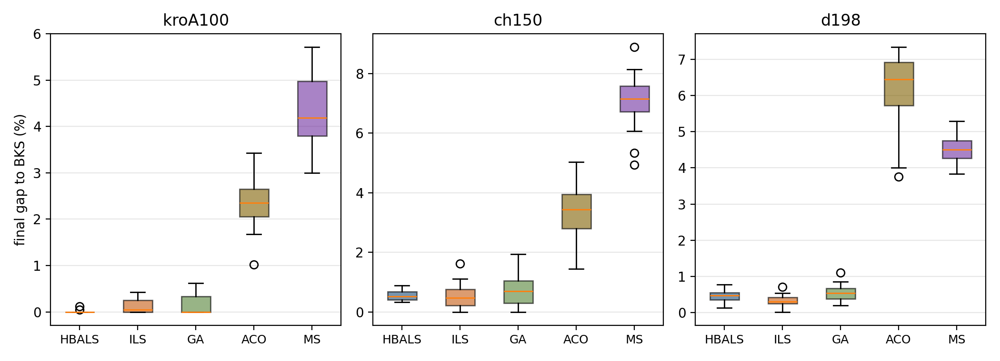
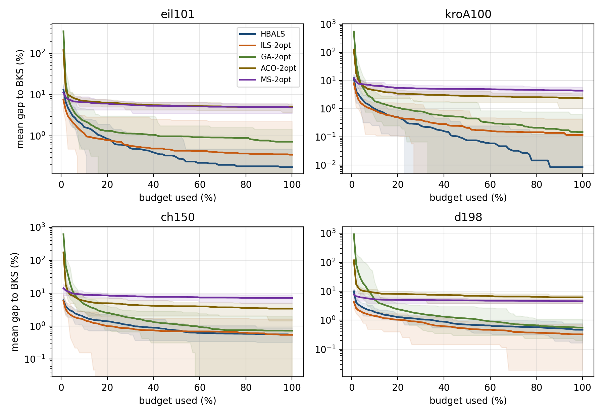
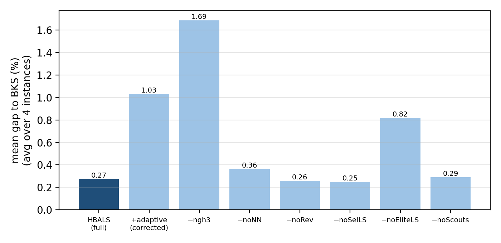

# HBALS: Hybrid Bees Algorithm with 2-opt Local Search for the Travelling Salesman Problem


-informational)

[](https://doi.org/10.5281/zenodo.23450861)


HBALS is a hybrid metaheuristic that combines the **Bees Algorithm (BA)** with **2-opt local search**, applied with different intensity at elite and selected sites, to solve the **Travelling Salesman Problem (TSP)**. It was my Bachelor's final project (*Computer Project* course, Islamic Azad University, Ardabil, 2026), supervised by Dr. Masoud Bekravi.

> **Status (v2).** This repository contains two versions of the study.
> **v1** is the original project (6 TSPLIB instances, iteration-based comparison).
> **v2** (folder [`v2/`](v2/)) is a revised study with an equal-budget protocol, an ablation, stronger baselines, 15 instances and
> non-parametric statistics. **The conclusions of v2 supersede those of v1.** v1 is kept unchanged for transparency, and
> [Corrections to v1](#corrections-to-v1) lists exactly what was wrong or misleading in it.

**Preprint (all versions):** [doi.org/10.5281/zenodo.23450861](https://doi.org/10.5281/zenodo.23450861)

## Contents

- [Results at a glance](#results-at-a-glance)
- [Research question](#research-question)
- [Method (v2)](#method-v2)
- [v2 evaluation](#v2-evaluation)
- [Corrections to v1](#corrections-to-v1)
- [v1 results (archived)](#v1-results-archived)
- [Repository structure](#repository-structure)
- [Setup and running](#setup-and-running)
- [Limitations](#limitations)
- [Future work](#future-work)
- [Project report and preprint](#project-report-and-preprint)
- [Academic information](#academic-information)
- [Citation](#citation)
- [Acknowledgments](#acknowledgments)
- [Contact](#contact)
- [License](#license)

## Results at a glance

Under an equal-budget comparison (same 2-opt operator, same number of move evaluations for every method):

| Finding | Evidence |
| --- | --- |
| HBALS has the **best average rank (1.25 of 6)** and the lowest mean gap (0.30 %) on 12 instances with 51-198 cities | Friedman test, p = 1.3e-10 |
| HBALS is significantly better than GA-2opt, ACO-2opt, multi-start 2-opt and plain BA | Wilcoxon signed-rank, Holm-adjusted p = 0.0024, better on all 12 instances |
| HBALS is **not** significantly different from iterated local search (ILS-2opt) overall | Holm-adjusted p = 0.13; HBALS better on 9 instances, ILS better on 3 |
| **ILS-2opt is better from about 195 cities upward** | significant on rat195, d198, a280 and lin318 (details below) |
| Elite-site 2-opt and a single-swap perturbation matter; segment reversal, selected-site 2-opt and scouts show no measurable effect | ablation, 4 instances x 20 runs |

HBALS is therefore a competitive memetic method on small and medium instances. It is **not** claimed to be a new state-of-the-art solver.





## Research question

The original question was whether adaptive local search improves the Bees Algorithm for the TSP. The revised study asks a broader and
more careful question: **what does a Bees-style hybrid contribute once it is compared fairly**, with the same local search and the same
computational budget for every method, and which of its components actually matter?

## Method (v2)

| Step | Stage | What it does |
| --- | --- | --- |
| 1 | Initialisation | Population of 20 tours: 10 Nearest-Neighbour tours (start cities 0-9) and 10 random tours |
| 2 | Evaluation and ranking | Scores each tour by total length and ranks the population; the best 3 are elite sites and the best 12 are selected sites |
| 3 | Elite-site search | 8 candidates per site: one random swap, then first-improvement 2-opt (at most 20 moves, probability 0.7) and, with probability 0.1, a random segment reversal |
| 4 | Selected-site search | 4 candidates per site: one random swap, then 2-opt (at most 10 moves, probability 0.3) |
| 5 | Scout bees | Random tours refill the population |
| 6 | Termination | Fixed budget of move evaluations (the equivalent of 300 iterations); **no early stopping** |

There is **no adaptive neighbourhood** in the final method: the ablation showed that it hurts (see below).

## v2 evaluation

**Protocol.** Every method gets the same budget of move evaluations on each instance and, where applicable, the same 2-opt operator.
Methods: HBALS, iterated local search (ILS-2opt), a memetic GA (GA-2opt), a memetic ant system (ACO-2opt), multi-start 2-opt and a plain
BA without local search. 20 runs per method on 12 instances (10 on three larger instances), seeds 1000 + run index. Statistics:
Mann-Whitney, Wilcoxon signed-rank and Friedman tests with Holm correction (see [`v2/`](v2/) and the paper).

### Mean gap to the best-known tour length (%), lower is better

| Instance | Cities | Best-known | HBALS best found | HBALS | ILS-2opt | GA-2opt | ACO-2opt |
| --- | --- | --- | --- | --- | --- | --- | --- |
| `eil51` | 51 | 426 | 426 | 0.035 | 0.200 | 0.317 | 0.739 |
| `berlin52` | 52 | 7542 | 7542 | 0.000 | 0.154 | 0.154 | 0.036 |
| `st70` | 70 | 675 | 675 | 0.030 | 0.348 | 0.385 | 1.200 |
| `eil76` | 76 | 538 | 538 | 0.158 | 0.316 | 0.641 | 1.980 |
| `kroA100` | 100 | 21282 | 21282 | 0.008 | 0.117 | 0.148 | 2.314 |
| `kroB100` | 100 | 22141 | 22141 | 0.237 | 0.351 | 0.301 | 1.769 |
| `eil101` | 101 | 629 | 629 | 0.175 | 0.350 | 0.723 | 4.976 |
| `lin105` | 105 | 14379 | 14379 | 0.160 | 0.208 | 0.379 | 1.418 |
| `ch130` | 130 | 6110 | 6110 | 0.601 | 0.676 | 0.903 | 4.238 |
| `ch150` | 150 | 6528 | 6549 | 0.545 | 0.541 | 0.722 | 3.377 |
| `rat195` | 195 | 2323 | 2338 | 1.184 | 0.837 | 1.539 | 5.712 |
| `d198` | 198 | 15780 | 15801 | 0.461 | 0.324 | 0.554 | 6.163 |
| `kroA200` (10 runs) | 200 | 29368 | 29435 | 0.463 | 0.712 | 1.416 | 11.293 |
| `a280` (10 runs) | 280 | 2579 | 2614 | 2.582 | 0.655 | 1.791 | 20.396 |
| `lin318` (10 runs) | 318 | 42029 | 42748 | 2.603 | 1.717 | 2.614 | 13.209 |

Multi-start 2-opt and the plain BA are in [`v2/results/tables/`](v2/results/tables/).

### Main findings

- On the 12 main instances HBALS has the best average rank (1.25 of 6; ILS-2opt 1.96, GA-2opt 2.96, ACO-2opt 4.00, multi-start 2-opt 4.83, plain BA 6.00). The rank difference to ILS-2opt is below the Nemenyi critical difference (2.18).
- HBALS is better than GA-2opt, ACO-2opt, multi-start 2-opt and plain BA on all 12 instances (Wilcoxon signed-rank, Holm-adjusted p = 0.0024).
- **HBALS is not significantly different from ILS-2opt** over the 12 instances (p = 0.13). Per instance (Mann-Whitney U on the 20 runs, Holm-adjusted):
  HBALS is significantly better on `eil51` (p = 0.001) and `kroA100` (p = 0.0007), and **ILS-2opt is significantly better on `rat195` (p = 0.011) and `d198` (p = 0.030)**.
  On the larger instances `a280` and `lin318` (10 runs) ILS-2opt is also better (unadjusted p = 0.0007 and 0.0017), while `kroA200` shows no significant difference (p = 0.38).
  In short, **ILS-2opt is better from about 195 cities upward** under this budget. HBALS is therefore *not* claimed to be a new state-of-the-art solver.
- Ablation (4 instances): 2-opt at the elite sites and a single-swap perturbation drive performance. The adaptive neighbourhood rule and a 3-swap perturbation
  are clearly harmful. Segment reversal, selected-site 2-opt and scout bees showed no measurable effect.
- Stopping a run after 20 non-improving iterations roughly tripled the average gap compared with using the full budget (0.95 % versus 0.30 %).
- **Reproducibility:** the full study was run on Windows 11 and re-run in a Linux container with different library versions. All 124 compared blocks
  (instance x method) were identical run by run: same tour lengths, evaluation counts and iteration counts (`v2/results/`, `v2/results_reference/`).



## Corrections to v1

The original (v1) project contained the following problems, found while preparing v2:

1. **The adaptive neighbourhood was inactive.** Because of integer truncation the neighbourhood size fell from 3 to 1 within two iterations and could not grow again, so v1 results were obtained with a single random swap. The corrected adaptive rule is harmful (v2 ablation), and the method is no longer called adaptive.
2. **The "3-opt" step was a random segment reversal**, a randomised 2-opt-type move, not a 3-opt move.
3. **Runs did not use 300 iterations.** The early-stopping rule (20 stagnant iterations) ended runs after about 38-94 iterations on average. v1 therefore understated the quality that the algorithm reaches.
4. **The baselines had no local search and a short, iteration-based budget**, so the v1 claim that HBALS had the lowest tour length on all six instances compared a method *with* 2-opt against methods *without* it. In v2, all methods share the same 2-opt and the same budget.

## v1 results (archived)

Kept as originally reported (6 instances, 20 runs, `fast` preset, early stopping as described above). Use the v2 results for conclusions.

| Dataset | Cities | Best | Mean | Std. dev. | Time (s) |
| --- | --- | --- | --- | --- | --- |
| `eil51` | 51 | 426 | 427.85 | 1.68 | 4.62 |
| `berlin52` | 52 | 7542 | 7543.00 | 2.00 | 5.31 |
| `st70` | 70 | 675 | 679.40 | 2.82 | 11.91 |
| `kroA100` | 100 | 21296 | 21388.60 | 79.06 | 39.17 |
| `ch150` | 150 | 6570 | 6627.95 | 40.13 | 83.68 |
| `rat195` | 195 | 2349 | 2375.30 | 14.16 | 161.51 |

The v1 comparison with BA, ACO, GA and PSO is in [`results/`](results) (with the caveats above), and the v1 convergence plots are in [`results/plots/`](results/plots).

## Repository structure

```
HBALS-TSP/
├── v2/                     # revised study (start here): see v2/README.md and v2/HOW_TO_RUN.md
│   ├── src/                # Numba implementations, runner, analysis, quick tests
│   ├── data/               # TSPLIB instances (EUC_2D)
│   ├── results/            # per-run results, anytime curves, tables, figures
│   ├── results_reference/  # independent re-run (identical results)
│   └── run_all.py
├── src/                    # v1 (original): hbals.py and baselines/ (ba, aco, ga, pso)
├── data/                   # v1: six TSPLIB instances
├── results/                # v1 results and plots
├── docs/
│   └── HBALS_paper.docx    # v1 project report (superseded, see Corrections to v1)
├── CITATION.cff
├── LICENSE
├── requirements.txt        # v1
└── README.md
```

## Setup and running

### v2 (recommended)

```
cd v2
pip install -r requirements.txt
python src/quick_test.py --instance eil51
python run_all.py --verify        # about 15-40 min: re-runs 4 instances and compares with the reference results
```

See [`v2/HOW_TO_RUN.md`](v2/HOW_TO_RUN.md) for testing your own instances and for the full study.

### v1 (original code)

```
pip install -r requirements.txt
python src/hbals.py --tsp-file data/eil51.tsp --preset fast --runs 20 --max-iter 300
python src/baselines/ba.py --tsp-file data/eil51.tsp --runs 20 --max-iter 300
```

(`aco.py`, `ga.py` and `pso.py` take the same arguments; replace `eil51.tsp` with any other file in `data/`.)

## Limitations

- Only Euclidean TSPLIB instances with at most 318 cities were evaluated; behaviour on clustered, asymmetric or much larger instances is unknown.
- ILS-2opt is better than HBALS from about 195 cities upward under this budget, and the ranking against ILS depends on the budget.
- The 2-opt operator restarts its scan after every improving move and uses no neighbour lists; its move limits (20 and 10) were not tuned.
- Parameters were not tuned for HBALS or the baselines; the ablation uses four instances and one change at a time.
- Specialised solvers such as LKH are far more effective on these instances.

## Future work

- A size-dependent move limit or a stronger local search (Or-opt, 3-opt with neighbour lists)
- A localised, segment-based perturbation instead of more random swaps
- A simplified HBALS without the components that showed no effect, tested on more instances and budgets
- Other instance classes (clustered, asymmetric) and larger sizes

## Project report and preprint

- **Preprint on Zenodo (all versions): [10.5281/zenodo.23450861](https://doi.org/10.5281/zenodo.23450861).** This DOI always resolves to the latest version.
  Specific versions: v2 (revised paper with supplementary information, matches `v2/`) [10.5281/zenodo.23621275](https://doi.org/10.5281/zenodo.23621275); v1.0 (original project preprint) [10.5281/zenodo.23450862](https://doi.org/10.5281/zenodo.23450862).
- [`docs/HBALS_paper.docx`](docs) is the v1 project report. It is superseded by v2 (see [Corrections to v1](#corrections-to-v1)).

## Academic information

| | |
| --- | --- |
| **Project** | HBALS: Hybrid Bees Algorithm with 2-opt Local Search |
| **Degree** | B.Sc. in Computer Engineering |
| **Course** | Computer Project |
| **University** | Islamic Azad University, Ardabil |
| **Year** | 2026 |
| **Supervisor** | Dr. Masoud Bekravi |

## Citation

If you use this implementation or build on this project, please cite the preprint:

> Khadiv, Erfan. (2026). *HBALS: A Hybrid Bees Algorithm with 2-opt Local Search for the Travelling Salesman Problem, Evaluated by Ablation and Equal-Budget Comparison*. Zenodo. <https://doi.org/10.5281/zenodo.23450861>

```bibtex
@misc{khadiv2026hbals,
  author = {Khadiv, Erfan},
  title  = {{HBALS}: A Hybrid Bees Algorithm with 2-opt Local Search for the
            Travelling Salesman Problem, Evaluated by Ablation and
            Equal-Budget Comparison},
  year   = {2026},
  doi    = {10.5281/zenodo.23450861},
  url    = {https://doi.org/10.5281/zenodo.23450861},
  note   = {Preprint, Zenodo. Code: https://github.com/ErfanKhadiv/HBALS-TSP}
}
```

Citation metadata is also provided in [`CITATION.cff`](CITATION.cff) (GitHub's "Cite this repository" button).

## Acknowledgments

- Dr. Masoud Bekravi supervised the *Computer Project* course under which this work was carried out.
- Problem instances come from TSPLIB (Reinelt, 1991). The Bees Algorithm was introduced by Pham et al. (2005).
- AI assistance: ChatGPT (OpenAI) and Claude (Anthropic) were used for language editing and for feedback on the manuscript and repository documentation. The independent Linux re-run in `v2/results_reference/` was produced in an AI assistant's code-execution environment, and the author's own full re-run on Windows 11 is in `v2/results/`. The author reviewed all content and takes full responsibility for the work.

## Contact

Erfan Khadiv · [github.com/ErfanKhadiv](https://github.com/ErfanKhadiv) · erfan.khadiv.dev@gmail.com

## License

Released under the MIT license; see [LICENSE](LICENSE).
